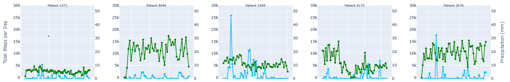
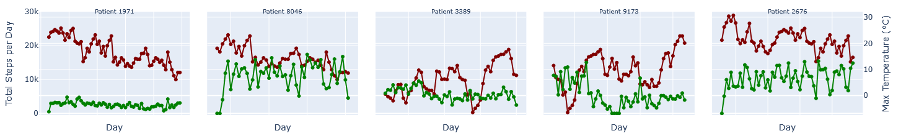
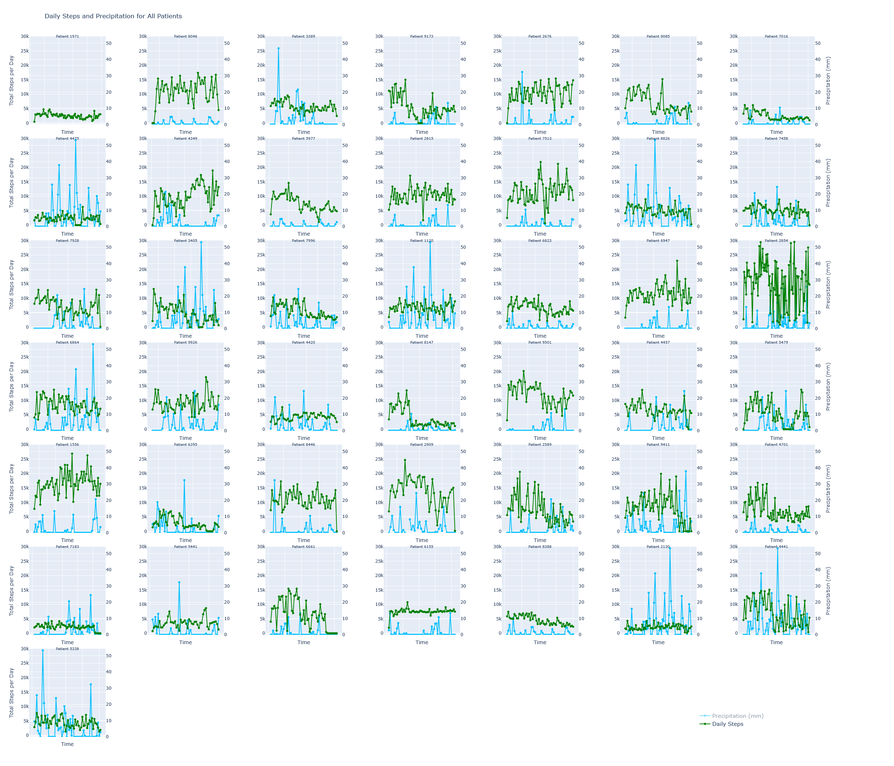
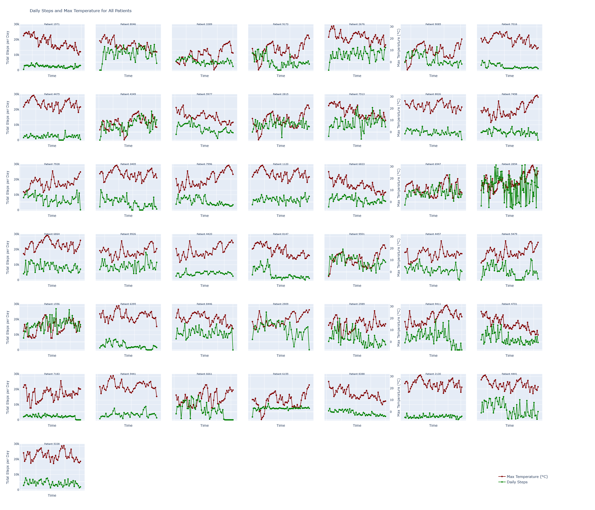
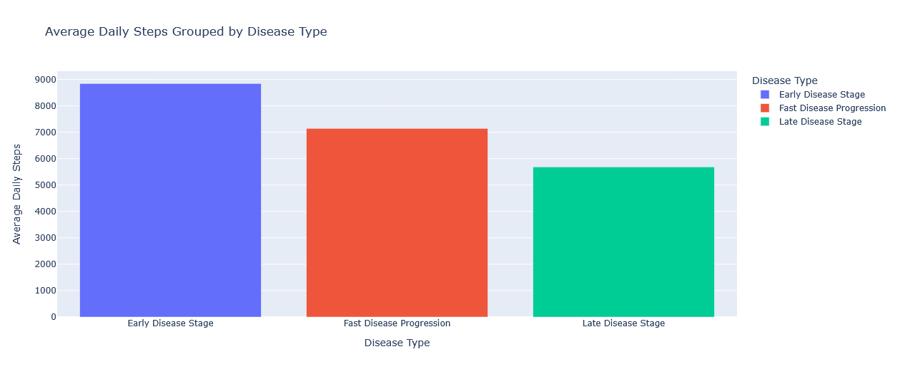
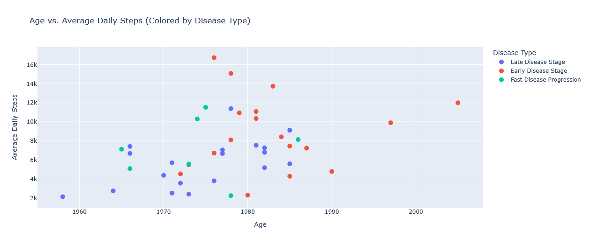
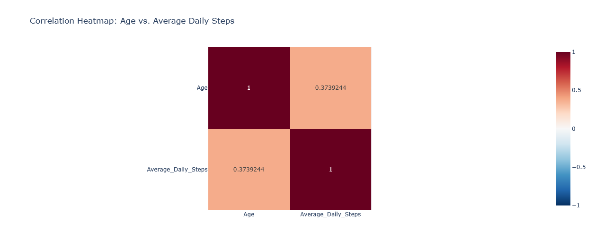
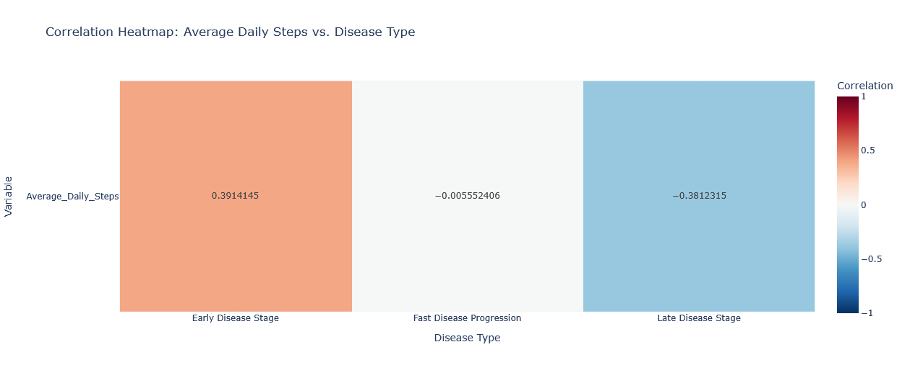
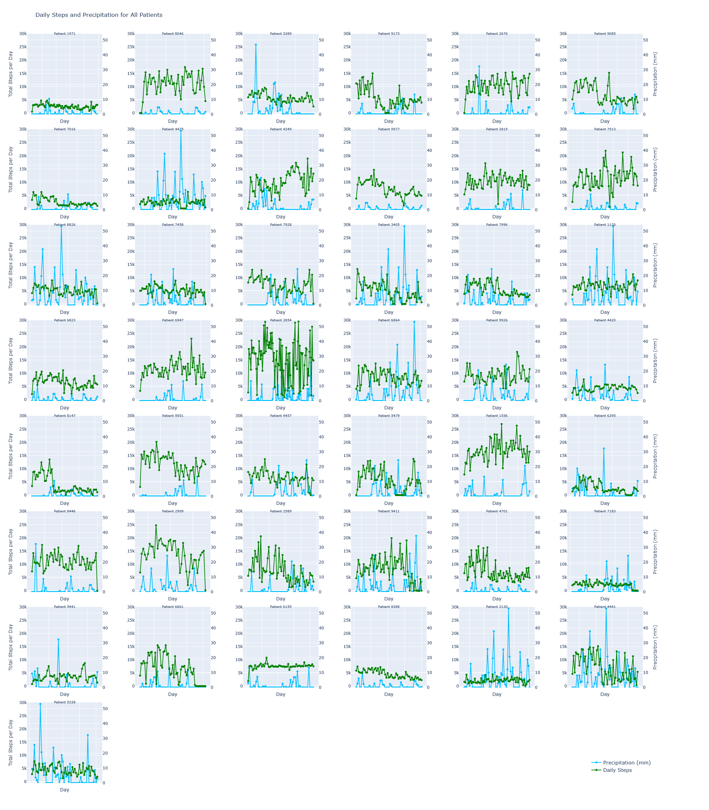

# Interactive Data Science in Digital Health Assignment
## Data analysis report

by @[CatrinaB](https://github.com/CatrinaB/)

**Note of consent**: I do **not** consent to this work being used, copied, or submitted by other people for any class taught at University of Zurich.

<!-- ### Introduction
% Describe the context, the motivation/goal of your analysis, and which
% information needs to be addressed. Tell which methods you applied, and which results you
% have uncovered. Also, describe shortly how you have validated your findings (e.g., through
% % visualizations, errors of regression models, p-values, etc) -->

### Background and related works
<!-- % ou may want to tell the reader more about the domain
% background, other related studies (related work), and data science approaches similar to
% yours. We expect you to include at least five carefully selected references. -->

Physical activity has been shown to influence the progression of chronic diseases: increased activity tends to delay the onset of disease or slow down its progression, while sedentarism tends to increase the likelihood of developing a chronic condition. [^Fang2026] [^Poleszak2026] Not only that, but the patients' mood and comorbidities like depression and anxiety are also affected, being easier to manage for people who are more active than for those who aren't. [^Stephens2019] However, physical activity is not something that exists in a vacuum: aside from the disease itself, it can also be influenced by external factors like temperature, humidity, or air pressure. [^Zhang2025] [^Ramadan2024]

As wearable sensor devices have become near ubiquitous and fairly accessible, researchers now have the opportunity to track patients in a more natural environment, for longer periods of time.[^Rekeland2022] [^Zhang2025] Thanks to the vast amounts of data generated, this presents the unique chance to better explore the influence of external factors on physical activity and to quantify it with "hard numbers" rather than subjective self-reports.

### Methods

All hypotheses have been tested for a subset of 43 participants: participant with ID 4063 has been excluded, because their recorded wearable data spanned less than 48 hours. Similarly, the intervention and follow-up phases have been ignored due to missing information on when they took place.

#### Hypothesis 1: Physical activity is related to weather

Based on (Zhang, 2025)[^Zhang2025], the first hypothesis I tested was that the physical activity of the patients was influenced by the weather; more specifically, warm (but not hot) weather with few precipitations would correlate to a higher number of steps than cold or hot weather and higher quantity of precipitation. To test it, I used historical data from MeteoSwiss (see [Section "Data characterization"](#data-characterization) for details), specifically daily maximum temperature and precipitation. I calculated the total number of steps a patient took for every measured day, retrieved the weather information for the corresponding days, and plotted the number of steps and the maximum temperature, respectively amount of daily precipitation. I conducted a visual analysis of the information and corroborated it using pandas' correlation function for each parameter.

#### Hypothesis 2: The general level of activity is influenced by age and disease stage

The second hypothesis I tested was if the general activity level of the patients' was directly related to their age and the progression stage of their disease, namely if younger people or those who are in the early stages are more physically active than older people an/or people who are in the later stages. I measured the average number of steps per day for each patient and calculated the correlation between this number and age, respectively disease type, and a multivariate correlation between steps and both age and disease type.

### Data characterization

I used three datasets:

1. clinical markers: 44 records containing the patients' ID, year of birth, sex, and disease type (early stage, late stage, fast progressing)
2. wearable data: a set of 44 files containing the hourly measured number of steps, minutes of sleep and average hourly heartbeat for each separate patient
3. historical meteorological data: I downloaded a dataset from the [MeteoSwiss Open Data Explorer](https://www.meteoswiss.admin.ch/services-and-publications/applications/ext/download-data-without-coding-skills.html) containing all the recorded meteorological data at the Zurich Fluntern meteorological station; from this I extracted a subset spanning only the year 2021 and containing the daily maximum air temperature measured at 2 metres above ground in Celsius and the average daily precipitation from 0 to 23:59 measured in millimetres (presumably per square metre).

### Implementation and sofware use
<!-- % Tell the reader more about your “technology stack”.
% Describe through which tools/programming languages/architectures your practical was
% realized. A few sentences will suffice.} -->

The entire practical work was conducted using the Python programming language and the Google Colab programming environment. I used the following Python packages:

- reading files: google.colab and os
- data analysis: pandas, numpy, statsmodels.api
- plotting: matplotlib.pyplot, plotly.graph_objects, plotly.subplots, seaborn, plotly.express

### Results

#### Hypothesis 1

Generally speaking, temperature and precipitation have little influence on the physical activity of a patient. During the visual analysis, I didn't observe any obvious trends, and the correlation coefficients support this finding. While there are a few patients for whom temperature is a significant factor for movement, overall the correlation factor is quite weak (tables [1](#tab-temp) and [2](#tab-pp)).

*Figure 1. Total number of steps (green) and total precipitation (blue) per day for 5 patients*

*Figure 2. Total number of steps (green) and maximum temperature (maroon) per day for 5 patients*

Patient_ID |  Correlation Steps—Temperature | 
|----|----|
7996 |  -0.6013 | 
2909 |  -0.5105 | 
6661 |  -0.4016 | 
9173 |  -0.2870 | 
4457 |  -0.2060 | 
7458 |  -0.2048 | 
8046 |  -0.1907 | 
2676 |  -0.1879 | 
3389 |  -0.1383 | 
7183 |  -0.1377 | 
9411 |  -0.1301 | 
7513 |  -0.0781 | 
9085 |  -0.0331 | 
6947 |  -0.0055 | 
6155 |  0.0094 | 
8826 |  0.0156 | 
7928 |  0.0244 | 
2854 |  0.0280 | 
4420 |  0.0653 | 
2130 |  0.0755 | 
2815 |  0.1127 | 
6395 |  0.1233 | 
1120 |  0.1365 | 
5441 |  0.2074 | 
2589 |  0.2136 | 
6823 |  0.2372 | 
5338 |  0.2393 | 
5977 |  0.2403 | 
4441 |  0.2474 | 
5479 |  0.2637 | 
6864 |  0.2646 | 
7016 |  0.2657 | 
9501 |  0.2764 | 
3405 |  0.2912 | 
1971 |  0.3619 | 
1556 |  0.3685 | 
4475 |  0.3704 | 
8446 |  0.3756 | 
4701 |  0.3985 | 
4349 |  0.4910 | 
8388 |  0.6066 | 
8147 |  0.6580 | 

*Table 1. Correlation factor between daily steps and maximum temperature*

Patient_ID |  Correlation Steps—Precipitation | 
|----|----|
5441 |  -0.4045 | 
7928 |  -0.3506 | 
2589 |  -0.3327 | 
9501 |  -0.2968 | 
4475 |  -0.2908 | 
1556 |  -0.2856 | 
9411 |  -0.2799 | 
7016 |  -0.2369 | 
2854 |  -0.2136 | 
3425 |  -0.1799 | 
9085 |  -0.1842 | 
2676 |  -0.1720 | 
9926 |  -0.1728 | 
5479 |  -0.1462 | 
8446 |  -0.1440 | 
6155 |  -0.0980 | 
4349 |  -0.0960 | 
8147 |  -0.0958 | 
4701 |  -0.0807 | 
6823 |  -0.0778 | 
8046 |  -0.0531 | 
7513 |  -0.0469 | 
6947 |  -0.0411 | 
6395 |  -0.0274 | 
1120 |  -0.0194 | 
4457 |  -0.0127 | 
7183 |  -0.0090 | 
6864 |  -0.0049 | 
4420 |   0.0052 | 
3389 |   0.0097 | 
9173 |   0.0259 | 
4441 |   0.0459 | 
2130 |   0.0486 | 
1971 |   0.0493 | 
7458 |   0.0521 | 
5977 |   0.0586 | 
5338 |   0.0642 | 
8826 |   0.0711 | 
8388 |   0.1355 | 
2815 |   0.1562 | 
2909 |   0.1840 | 
6661 |   0.2121 | 
7996 |   0.2317 | 

*Table 2. Correlation factors of daily steps and precipitation*

Figures [1](#fig-pp5) and [2](#fig-temp5) show a comparison between the number of steps and the maximum temperature or the total precipitation for 5 patients. The graphs for all 43 patients are represented in figures [3](#fig-pp77) and [4](#fig-temp77).

*Figure 3. Total number of steps (green) and total precipitation (blue) per day for all 43 patients*

*Figure 4. Total number of steps (green) and maximum temperature (maroon) per day for all 43 patients*

#### Hypothesis 2

At first, grouping the average number of steps by disease type and then calculating the average for each group ([figure 5](#fig-bar_steps_disease)) suggests that people in the early disease stage move more than those in the late stage, which is to be expected. However, creating a scatterplot of each patient's average daily number of steps, age, and disease type reveals that there is no clear clustering of the data ([figure 6](#fig-scatter_age_disease_steps)). The individual correlation factor shows a weak correlation between steps and age, respectively disease type (figures [7](#fig-heatmap_age_steps) and [8](#fig-heatmap_disease_steps)). When calculating the multivariate correlation, I obtained an **R-squared value of 0.2205** and a **multiple correlation coefficient of 0.4695**; this suggests that age and disease type have a weak to moderate influence on a patients amount of physical activity.

*Figure 5. Average number of average daily steps per disease type*

*Figure 6. Distribution of disease type and number of steps by age*

*Figure 7. Heatmap of correlation between age and average number of daily steps*

*Figure 8. Heatmap of correlation between disease and average number of daily steps*

*Figure 9. Representation of daily step total (green) and daily maximum temperature (maroon)*

<!-- % % Requires: \usepackage{booktabs}
% \begin{table}[h]
%     \centering
%     \caption{Placeholder Caption}
%     \label{tab:placeholder_label}
%     \begin{tabular}{cc}
%         \toprule
%         Patient\_ID |  Correlation Steps--Temperature | 
%         \midrule
%         7996 |  -0.6013 | 
%         2909 |  -0.5105 | 
%         6661 |  -0.4016 | 
%         9173 |  -0.2870 | 
%         4457 |  -0.2060 | 
%         7458 |  -0.2048 | 
%         8046 |  -0.1907 | 
%         2676 |  -0.1879 | 
%         3389 |  -0.1383 | 
%         7183 |  -0.1377 | 
%         9411 |  -0.1301 | 
%         7513 |  -0.0781 | 
%         9085 |  -0.0331 | 
%         6947 |  -0.0055 | 
%         6155 |  0.0094 | 
%         8826 |  0.0156 | 
%         7928 |  0.0244 | 
%         2854 |  0.0280 | 
%         4420 |  0.0653 | 
%         2130 |  0.0755 | 
%         2815 |  0.1127 | 
%         6395 |  0.1233 | 
%         1120 |  0.1365 | 
%         5441 |  0.2074 | 
%         2589 |  0.2136 | 
%         6823 |  0.2372 | 
%         5338 |  0.2393 | 
%         5977 |  0.2403 | 
%         4441 |  0.2474 | 
%         5479 |  0.2637 | 
%         6864 |  0.2646 | 
%         7016 |  0.2657 | 
%         9501 |  0.2764 | 
%         3405 |  0.2912 | 
%         1971 |  0.3619 | 
%         1556 |  0.3685 | 
%         4475 |  0.3704 | 
%         8446 |  0.3756 | 
%         4701 |  0.3985 | 
%         4349 |  0.4910 | 
%         8388 |  0.6066 | 
%         8147 |  0.6580 | 
%         \bottomrule
%     \end{tabular}
% \end{table}

% \begin{figure}
%     \centering
%     \includegraphics[width=0.99\linewidth]{steps-pp95.png}
%     \caption{Enter Caption}
%     \label{fig:placeholder}
% \end{figure} -->

### Discussion
<!-- % Discussion. Summarize the most important results and put them into an (international)
% context. That means: tell readers how your results align with the results of other studies, but
% also in which ways your results disagree. The discussion section is also the right place to be
% critical with your own approach. -->

The results are surprising, as, contrary to the literature, there is no clear significant correlation between physical activity and weather or disease progression. However, the approach was not thorough, lacking statistical analyses or deeper exploration.

### Limitations
The most important limitation is, in my opinion, the number of patients that had their data recorded. I believe a cohort of 44 people is not big enough to lead to statistically significant results, but rather it can be used as a starting point for bigger and more thorough experiments.

Another limitation is the limited data on the patients' lifestyle. It is mentioned in the homework description that the patients have spent a period of time in a specialised rehabilitation facility, after which they went home and continued to wear the Fitbit bracelets. However, there is no indication in the data provided when this move took place; as people tend to be more serious about physical therapy in a controlled environment, but then be less rigorous at home or other non-controlled environments, it is possible the results are not completely relevant. For similar reasons it might also help knowing whether the patients have support at home or not.

Finally, the patient measurements were taken in 2021, during the SARS-CoV-2 pandemic. As such, it is possible that the measured data was influenced by whether or not the patient had had SARS-CoV-2 or whether they were administered the vaccine, or that the patients' behaviour was influenced by the pandemic and the public health measures in place (e.g., they quarantined themselves in order to avoid getting infected). However, this information is not available, but it might significantly alter the results.

<!-- % ### Reflections}
% % You are asked to put emphasis on your own experiences made during the
% % elaboration of the homework. This is your chance to reflect on your journey made, and to put
% % emphasis on the process dimension of this homework (challenges, how you overcame them,
% % what you have learned) as opposed to the outcomes only.}

% ### Conclusions}
% add advice to subject experts/domain experts based on your finds. Summarize
% and point out future work} -->

### Declaration of AI use
<!-- % This is where you declare any use of generative AI. Declare the goals you
% had using it, the prompts, the outputs, and the way how it shaped your hopework} -->
I used Google Colab's generative AI engine Gemini to generate the code and the plots I used in this homework, as well as suggested auto-completions for the code I wrote myself. Since I have previous experience with pandas, numpy, matplotlib and seaborn, I decided it would be faster for me to review and correct the generated code than write it by hand. The hypotheses, methods of evaluation, and results were decided and interpreted respectively by me with no input from Gemini.

<!-- % The prompts I used in Gemini are the following:

% using the files in My Drive/Colab Notebooks/IVDA/Hourly Sensor Data, create an array calle "patients" where each entry has the data in a file form that folder

% for patients[0], generate two graphs: one shows the evolution of steps in time, the other the evolution of heartrate in time. label the x and y axis with "Time (s)" and "Steps" or "Heartrate (bpm)" respectively, don't label the x-axis ticks, and use alternating background colors for alternating days 

% Make the graphs zoomable , and when I zoom in on one graph I want the other to zoom in in the exact same manner

% Using the data in weather_data_df, create a plot that shows both the total number of steps per day and the maximum temperature for that same day for all patients 
% Set all the plots to the same yaxis range: -500-30000 for steps and the global minimum and maximum temperature spanning only weather_data_df, regardless of patient data, for daily temperature -->

[^Fang2026]: Fang, Z., Wang, P., Rosner, B., Giovannucci, E., & Song, M. (2026). Sustained physical activity offers benefits beyond activity volume in chronic disease prevention. *Nature Communications, 17*. https://doi.org/10.1038/s41467-026-69552-4

[^Poleszak2026]: Poleszak, J., Luba, Z., Tyszko, K., Rusek, K., Pikur, K., G´orska, A., B la˙zukiewicz, J., Balicki, J., NIDA, A., & Posturzy´nska, A. (2026). Lifestyle, diet, and physical activity in the prevention and rehabilitation of chronic diseases: A review. *Wiadomo´sci Lekarskie, 79*,
518–524. https://doi.org/10.36740/WLek/217892

[^Ramadan2024]: Ramadan, G., Samin, G., Haryanto, A., Kadir, S., & Okilanda, A. (2024). A cross-sectional study: The impact of extreme weather, sleep quality, and physical activity. *Retos, 60,* 968–973. https://doi.org/10.47197/retos.v60.109307

[^Rekeland2022]: Rekeland, I., Sørland, K., Bruland, O., Risa, K., Alme, K., Dahl, O., Tronstad, K. J., Mella, O., & Fluge, Ø. (2022). Activity monitoring and patient-reported outcome measures in myalgic encephalomyelitis/chronic fatigue syndrome patients. *PLOS ONE, 17,* e0274472. https://doi.org/10.1371/journal.pone.0274472

[^Stephens2019]: Stephens, S., Shams, S., Lee, J., Grover, S., Longoni, G., Berenbaum, T., Finlayson, M., Motl, R., & Yeh, E. (2019). Benefits of physical activity for depression and fatigue in multiple sclerosis: A longitudinal analysis. *The Journal of Pediatrics, 209*. https://doi.org/10.1016/j.jpeds.2019.01.040

[^Zhang2025]: Zhang, Y., Folarin, A., Ranjan, Y., Cummins, N., Rashid, Z., Conde, P., Stewart, C., Sun, S., Vairavan, S., Matcham, F., Oetzmann, C., Siddi, S., Lamers, F., Simblett, S., Wykes, T., Mohr, D., Haro, J., Penninx, B., Narayan, V., & Pratap, A. (2025). Assessing seasonal and weather effects on depression and physical activity using mobile health data. *npj Mental Health Research*, 4. https://doi.org/10.1038/s44184-025-00125-x

